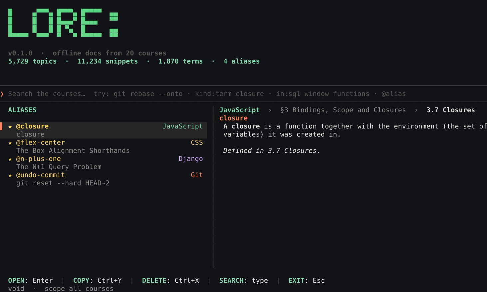
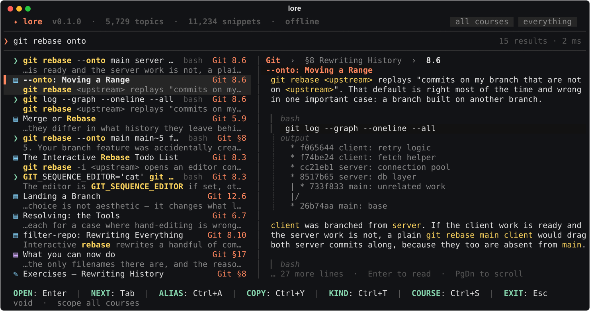
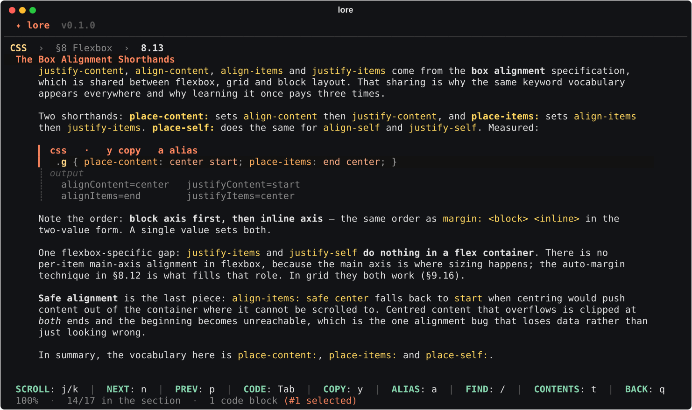

<div align="center">



# lore

**Your courses, searchable offline, from the terminal.**
Topics, code snippets and definitions from every course in `programming-material`, with live suggestions, a preview, and aliases for the things you look up again and again.

</div>

## What it does

- **Search as you type.** Words, a command (`git rebase --onto`), an identifier (`useEffect`) or a question (`what is a closure`). Results update on every key, ranked by where the match is (title, headings, text, code), and typos are repaired (`rebsae` → `rebase`).
- **Three kinds of result.** ▤ topics (a subsection of a course), ❯ code snippets (with the output the course printed under them) and ◆ definitions (the bold terms the courses define).
- **A preview next to the list**, a **reader** for the full topic, and one key to copy a code block.
- **Aliases.** Save any result under a short name and bring it back with `lore @name`, from the terminal or the interface.
- **Offline and instant.** Everything is one SQLite file on your machine. A search takes a few milliseconds.

<p align="center">

</p>

## Install

```sh
./install.sh                  # own virtualenv, `lore` linked into ~/.local/bin, index built
# or, if you prefer to manage it yourself:
pipx install .                # or: pip install .
lore                          # the first run builds the index (a few seconds)
```

lore reads the course sources from `~/programming-material/_build/sources`. If they live somewhere else:

```sh
lore index --source /path/to/_build/sources     # builds the index and remembers nothing else
export LORE_SOURCE=/path/to/_build/sources      # or set it once, for `lore index` and the first run
```

Run `lore index` again whenever the courses change (a new course, a rewritten section). It takes about three seconds, never touches your aliases, and the interface tells you when the sources are newer than the index.

Requires Python 3.10+ on macOS or Linux.

## Using it

```sh
lore                          # open the interface
lore git rebase onto          # …already searching
lore -c sql window functions  # limit to one course
lore @undo                    # print an alias
```

| | |
| --- | --- |
| **type** | search; the list and preview follow you |
| **↑ ↓** · Tab / Shift+Tab | move through the suggestions |
| **Enter** | read the selected result |
| **Ctrl+A** | save it as an alias |
| **Ctrl+Y** | copy the snippet, definition or topic |
| **Ctrl+T** · **Ctrl+S** | cycle the kind (topics, snippets, terms) · cycle the course |
| **Ctrl+O** | print the selection and quit (see *Use it as a picker*) |
| **PgUp PgDn** | scroll the preview |
| **Esc** | clear the query; leave when it is empty |
| **F1** · **?** | every key |

Filters can be typed in the query: `in:git` or `@git` (a course), `kind:term` · `kind:snippet` · `kind:topic`, and `lang:bash` (snippets in one language). They combine: `in:sql kind:snippet window frame`.

### The reader

Enter opens the topic in a scrolling reader with syntax-highlighted code, the output the course printed, and the exercises' solutions drawn as a rail.

| | |
| --- | --- |
| **j k** · ↑ ↓ · Space / b · d / u · g / G | scroll |
| **n** / **p** | next / previous topic in the course |
| **Tab** / Shift+Tab | select the next / previous code block |
| **y** | copy the selected code block (or the whole topic when none is selected) |
| **a** | alias the selected code block (or the topic) |
| **/** · **]** **[** | find in the page · next / previous match |
| **t** | contents of the whole course; jump anywhere |
| **P** | print the selection to the terminal and quit |
| **q** · Esc | back to the search |

<p align="center">

</p>

## Aliases

An alias is a name for something you want back quickly: a topic, one code block, a definition, or a note of your own.

```sh
lore alias add undo "git reset --soft"       # alias the best match for a query
lore alias add undo git:7.3#1                # …or an exact id (topic git:7.3, its first snippet git:7.3#1)
lore alias add deploy --text "kubectl rollout undo deploy/web"   # your own text ('-' reads stdin)
lore alias ls                                # name, kind, and what it points at
lore alias mv undo soft-reset
lore alias note soft-reset "keeps my changes staged"
lore alias rm soft-reset

lore @undo                   # print it: a snippet prints its code, a topic opens in your pager
lore @undo -y                # …and copy it
lore @undo -o                # open it in the reader
$(lore @undo --code)         # use a snippet's code directly
```

In the interface, press **Ctrl+A** on a result (or **a** in the reader) and type a name. A name already in use asks you to press Enter again before replacing it. With an empty query the start screen lists your aliases, most recently used first, followed by what you opened and searched for recently; type `@` and part of a name to find one. **Ctrl+X** (twice) deletes the selected alias.

Aliases are stored in `~/.local/share/lore/aliases.json` and survive `lore index`. A pointer remembers the course, the title and, for a snippet, a fingerprint of its code, so it is found again if a course is renumbered; `lore alias ls` marks those as *(moved)*.

## Use it as a picker

`lore --pick` draws the interface on your terminal even when its output is piped, and prints what you choose with **Ctrl+O** (or **P** in the reader):

```sh
lore --pick git rebase | pbcopy                   # choose a snippet, land it on the clipboard
git "$(lore --pick -k snippet git log graph)"     # …or straight into a command line
```

## For scripts

```sh
lore search closure -n 5               # id, kind, course, title
lore search "window frame" --json      # machine-readable
lore get git:7.3 --raw                 # a topic's markdown
lore get "closure" -k term             # the best match for a query
lore courses                           # the courses in the index and their sizes
lore info                              # where everything lives, when the index was built
```

Item ids are `course:number` for a topic (`git:7.3`), `course:number#N` for its Nth code block, and `course:term:slug` for a definition. Anything that prints to a pipe gives plain text, never colour codes.

## Configuration

`~/.config/lore/config.toml` (everything optional):

```toml
theme = "void"            # void | nebula | matrix  (the same three as ember)
editing_mode = "emacs"    # or "vi" for the search box
preview = "auto"          # auto | on | off — auto hides it below 100 columns
source = "~/programming-material/_build/sources"
```

`LORE_HOME` moves lore's data and config to one directory; `LORE_SOURCE` overrides the course location.

## How it works

`lore index` reads each course's assembled source (`<course>.md`: a `===META===` header, an `===INTRO===`, `===SECTION: …===` blocks of `## N.M` subsections, a `===CONCLUSION===`) and builds one SQLite database with FTS5:

- every `## N.M Title` subsection becomes a **topic**, with its HTML callouts, figures and `<details>` solutions rewritten into plain markdown;
- every fenced code block becomes a **snippet**, with the output block under it, the sentence that introduced it, and a fingerprint;
- every sentence of the form "**A term** is …" becomes a **definition**.

Search runs a full-text query over title, headings, text and code with weights, re-ranks by how the title matches, repairs unknown words against the vocabulary of titles, and falls back to substring matching on names. About 5,700 topics, 11,000 snippets and 1,900 definitions come to roughly 40 MB.

## Development

```sh
python -m venv .venv && .venv/bin/pip install -e '.[dev]'
.venv/bin/python -m pytest                    # unit tests plus the interface driven through a pseudo-terminal
.venv/bin/python scripts/screenshots.py       # re-record docs/assets/*.svg from the real interface
```

Built on [prompt_toolkit](https://github.com/prompt-toolkit/python-prompt-toolkit) (layout and input), [Rich](https://github.com/Textualize/rich) (markdown and code rendering) and [Pygments](https://pygments.org/) (highlighting), like [ember](https://github.com/arthurdaquinosilva/ember).

## License

MIT © Arthur D'Aquino
